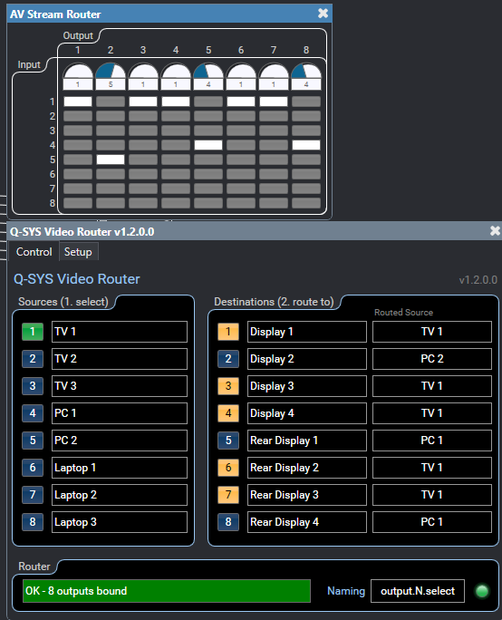
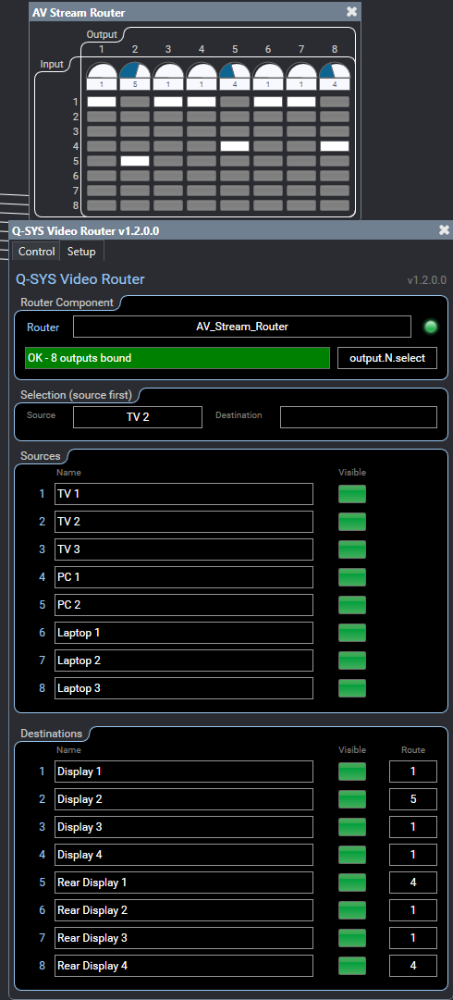

# Q-SYS Video Router

A Q-SYS plugin that puts an operator routing panel on any router in a design:
Router, Router with Mixer, or MediaCast Router. Pick a source, then pick where
it goes.



## Setup

1. **Install.** In Q-SYS Designer 10.1 or later: at <https://library.qsys.com>,
   open **My Library > My Packages > Add Personal Package**, name it
   `Q-SYS Video Router`, and use this Package URL:

   ```
   https://raw.githubusercontent.com/isaaacporter/q-sys-plugin-q-sys-video-router/main/feed/index.json
   ```

   Then in Designer, open **Tools > Show Asset Installer** and install
   `QSYS-Video-Router`.
2. **Allow script access.** Set **Script Access** to *Script* or *All* on the
   router component.
3. **Add the plugin** to the design and set its properties: **Source Count**
   and **Destination Count** (1-64), **Default Mode** (Matrix or All), and
   **Matrix Select Order** (Source First or Destination First).
4. **Pick the router.** On the **Setup** tab, choose it from the **Router**
   drop-down. The LED lights and the status shows how many outputs are bound.
5. **Name the sources and destinations**, and turn off **Visible** for any that
   aren't connected. Each Visible toggle is also a pin, so room logic or a
   sync detect can drive it.



## Routing

- **Source first** (default): press a source, then press the destinations to
  send it to. Destinations already showing that source are lit.
- **Destination first**: press a destination, then the source it should show.
- **One-To-All**: press a source and it goes to every output.

Each destination's **Routed Source** box shows what it's watching, and picking a
source there routes it directly. Routes made anywhere else in the design show up
here too.
